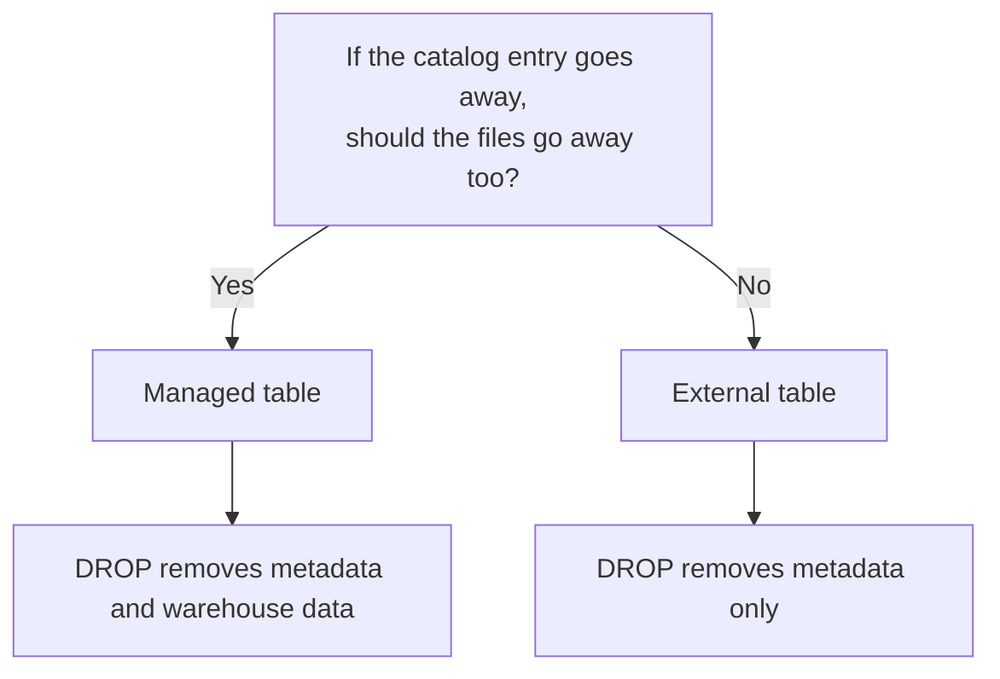
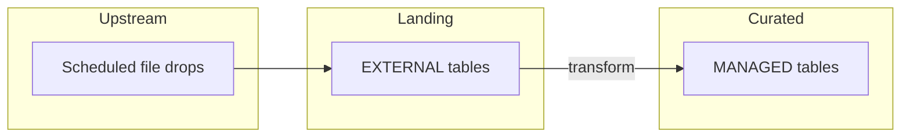
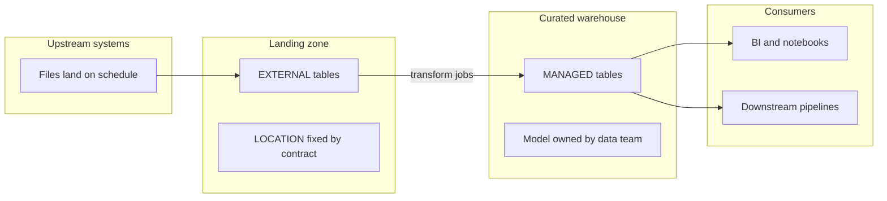

Two cutovers, two opposite failures, same root cause.

In the first, we needed a full reload of five years of history for a
partner-facing interface. The playbook was familiar: `DROP TABLE`, recreate the
DDL, run the backfill. The table was **external**, but the steps were written like
a managed refresh — drop the name, load again, validate against upstream. `DROP
TABLE` succeeded; nobody deleted the files at the declared `LOCATION`. The reload
landed on top of the old prefix. Row counts and key checks against upstream failed,
not because the new extract was wrong, but because queries were reading **old and
new files together**. After someone cleared the prefix manually, we registered the
table again and ran the five-year load **twice**. Same root mistake: on external
tables, `DROP TABLE` is not "empty the landing."

In the second, someone `DROP TABLE`d a mart that analysts still bookmarked in a
wiki. The metastore entry vanished **and** the warehouse directory disappeared.
A batch job had been reprocessing from that path for years. Recovery meant restore
from backup, not `CREATE TABLE` again — because it had been **managed**, and
`DROP TABLE` meant **delete the product**.

*Disclosure: I used an AI assistant to help draft and structure this write-up.
The operational patterns and review checklist are drawn from production DDL
reviews; the opening incidents are composites, not single tickets.*

Hive makes you choose managed vs external in DDL (or you inherit a choice from
whoever wrote the script years ago). In Hive 3 the mechanics are documented; the
hard part is aligning them with **who owns the lifecycle**, not debating ORC vs
Parquet.

## The one business question

Ask stakeholders this before anyone writes DDL:

> If we remove the table from the catalog, should the underlying files disappear?

| Answer | Table type | What you are saying |
|--------|------------|---------------------|
| **Yes** | **Managed** | This dataset is **our product**. Retiring it includes reclaiming storage. |
| **No** | **External** | The files are a **shared asset** or **system of record elsewhere**. The table is a named pointer. |



Everything else — ACID, compaction, `MSCK REPAIR`, whether Spark can `DELETE` —
follows from that line.

## At a glance

| | **Managed** | **External** |
|---|-------------|--------------|
| **DDL** | `CREATE TABLE ...` | `CREATE EXTERNAL TABLE ... LOCATION '...'` |
| **Default path** | Under metastore warehouse dir | Path you declare |
| **`DROP TABLE`** | Metadata + table data removed (trash/PURGE per distro) | Metadata only; files stay |
| **`TRUNCATE TABLE`** | Removes data files, keeps table | Same idea on external data dir — **dangerous** if others share the path |
| **Typical zone** | Curated marts, modeled dims/facts | Landing, partner feeds, shared lake prefixes |
| **Who owns bytes** | Your data team / warehouse | Often upstream or platform |

## Managed tables: the platform owns the default path

A **managed** table is the default when DDL says `CREATE TABLE` without
`EXTERNAL`. Data is stored under the warehouse directory configured on the
metastore (`hive.metastore.warehouse.dir` on older clusters; cloud connectors
use equivalent default prefixes on ADLS, S3, or GCS).

**Business fit**

- **Analytics products you control** — conformed dimensions, facts, staging built
  only by your pipelines.
- **Clear accountability** — decommissioning includes `DROP TABLE` and reclaiming
  space.
- **Governance** — SLAs and access line up with *your* schema.

**What operators actually run**

```sql
CREATE TABLE analytics.dim_channel (
  channel_key   INT,
  channel_name  STRING
)
STORED AS ORC;
```

`CREATE TABLE AS SELECT` and `CREATE TABLE ... AS SELECT` without `EXTERNAL`
also create **managed** tables unless your session overrides say otherwise — a
common surprise when a one-off CTAS lands in the warehouse and nobody remembers
to externalise it.

`INSERT OVERWRITE` on a managed table replaces the dataset in place under that
warehouse path. Consumers see one logical name; the storage location is Hive's
problem.

When you `DROP TABLE` on managed, Hive drops metadata and deletes the table's
warehouse data. Distributions may route deletes through trash; `DROP TABLE ...
PURGE` skips trash on managed tables where supported. That is what you want when
retiring **your** mart — and what you must not run when you only meant to
unregister a landing alias.

## External tables: metadata points at existing files

**External** tables are declared with `CREATE EXTERNAL TABLE ... LOCATION '...'`.
The metastore holds schema and partition columns; **bytes live at the location**,
often written first by ingestion or another engine.

**Business fit**

- **Landing boundaries** — upstream drops files; Hive registers them.
- **Shared lake trees** — one Parquet layout, many readers; dropping one Hive
  name must not wipe the canonical copy.
- **Compliance** — catalog can go; evidence on disk stays until retention policy
  says otherwise.
- **Migration** — register legacy paths while rewrite jobs catch up.

```sql
CREATE EXTERNAL TABLE landing.raw_orders (
  order_id    STRING,
  order_ts    TIMESTAMP
)
PARTITIONED BY (dt STRING)
STORED AS PARQUET
LOCATION 's3://data-lake/landing/orders/';
```

`DROP TABLE landing.raw_orders` removes the metastore entry **only**. Files at
`LOCATION` stay until something else deletes or overwrites them — the failure mode
in the first opening story.

Partitioned external tables often need `MSCK REPAIR TABLE` or explicit
`ALTER TABLE ... ADD PARTITION` when directories appear on disk before DDL catches
up. That toil is the price of the filesystem being authoritative.



## What this is not

**Neither choice is inherently faster or more secure.** Formats, partitioning,
file sizes, and skew dominate read cost. IAM and policy dominate security. "External
for speed" usually means **the files were already there**, not a magic keyword.

**Neither choice replaces a data contract.** External names at boundaries; the
contract is path and layout. Managed names in the curated zone; the contract is
the model consumers trust.

## Three mistakes I see in production reviews

**1. `DROP` without `DESCRIBE FORMATTED`**

Before a cleanup sprint, print type and location:

```sql
DESCRIBE FORMATTED analytics.dim_channel;
DESCRIBE FORMATTED landing.raw_orders;
```

Look for `Table Type: MANAGED_TABLE` vs `EXTERNAL_TABLE` and the `Location:` line.
If that does not match what the ticket says, stop.

**2. Shared `LOCATION` prefixes**

Two external tables (or one external and one sloppy `INSERT`) pointed at the same
prefix make `TRUNCATE` or overwrite a **cross-team incident**. External is not
"safer"; it is **shared ownership of a path**.

**3. CTAS by default in the warehouse**

Ad hoc `CREATE TABLE … AS SELECT` creates managed tables in the default database
unless you externalise on purpose. Six months later nobody remembers, and `DROP`
deletes work somebody thought was "just a temp extract."

## Before you DROP (five-minute checklist)

Run this on every cleanup ticket, not only "big" tables:

1. `DESCRIBE FORMATTED schema.table;`
2. Read **`Table Type:`** — `MANAGED_TABLE` vs `EXTERNAL_TABLE`.
3. Read **`Location:`** — who else might write or truncate that prefix?
4. Compare to the ticket: "remove catalog entry" vs "reclaim storage."
5. If managed and you only meant to unregister, **`DROP` is the wrong tool** —
   use rename, archive policy, or an external pointer instead.

If step 2 and step 4 disagree, stop and escalate. That mismatch is how both
opening incidents happened.

## Hive 3 wrinkles worth knowing

**Transactional (ACID) tables.** In Hive 3, **external tables are not
transactional.** Native ACID (`UPDATE`/`DELETE`/`MERGE`, compaction, consistent
snapshots) needs Hive to own and rewrite the data files. On an external table the
bytes live at a `LOCATION` outside that control, so making an external table ACID
is disallowed ([HIVE-13175][h13175]). Full ACID assumes layouts Hive manages.
Marts that need row-level change belong in **managed transactional** tables in a
curated schema, not on a shared landing prefix.

Formats like Delta or Iceberg on object storage carry **their own** transaction
logs and lifecycle; that is a different model from Hive native ACID on
`CREATE EXTERNAL TABLE`. Expecting `DELETE` to work because the table "looks
curated" but is still external is how you end up in the "Spark says DELETE is not
supported" post, slated for #8 in this series.

**Renames and `ALTER TABLE SET LOCATION`.** Renaming a managed table is a catalog
+ warehouse concern. Changing `LOCATION` on external repoints metadata without
moving files — useful when migrating buckets, fatal if someone thinks rename moved
bytes.

**Cloud warehouses.** Warehouse dir and `LOCATION` are URLs. The business question
is unchanged: who may delete the prefix when the catalog entry disappears?

## A workshop line that lands with non-engineers

Draw three zones on a whiteboard:

```text
landing/     EXTERNAL  — upstream owns bytes; we register and read
curated/     MANAGED   — we own model + lifecycle
archive/     EXTERNAL  — long retention; catalog optional
```



Your company may not name folders that way. The **ownership line between landing
and curated** is where managed vs external arguments actually get decided.

## Spark and Delta use the same question

Spark SQL and Delta expose the same tension under different words: default
`saveAsTable` paths vs `path '...'` on `CREATE TABLE`, external locations on
shared ADLS prefixes, `DROP TABLE` vs `DELETE` on Delta. The vocabulary changes;
**who may delete the directory when the table name goes away** does not. If you
only remember one sentence for a multi-engine lake, remember that one.

## What is measured here, and what is not

The **DROP / EXTERNAL / managed** behaviour is documented in Hive's
[LanguageManual DDL][langddl]. Vendor distros add trash, export, and Ranger hooks
— verify on your cluster before a production `DROP`.

The **two opening incidents** are composites of common mistakes (external reload
without clearing `LOCATION` after `DROP`; data loss after managed `DROP`). They are
not one verbatim ticket.

The **zone pattern** is widely described in lake design; your org may invert a
layer for history. The decision question still applies.

DDL and `DESCRIBE FORMATTED` examples for Gist embeds live under
`posts/002-managed-vs-external/gists/` in the blog repo.

## Sources

- [Apache Hive — LanguageManual DDL][langddl]
- [Apache Hive — Hive Transactions (ACID)][acid]
- [Apache Hive — Design documents][designdocs]
- [HIVE-13175 — disallow making external tables transactional][h13175]

[langddl]: https://cwiki.apache.org/confluence/display/Hive/LanguageManual+DDL
[acid]: https://cwiki.apache.org/confluence/display/Hive/Hive+Transactions
[designdocs]: https://hive.apache.org/development/designdocs/
[h13175]: https://issues.apache.org/jira/browse/HIVE-13175
